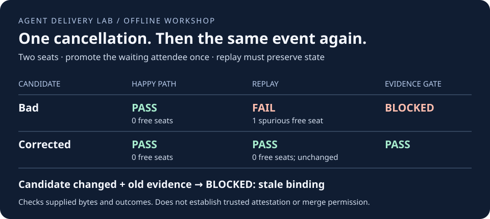

# Agent Delivery Lab

**Catch incomplete checks and stale evidence before a delivery handoff.**

Four portable skills help you scope a change, define expected outcomes, implement
it, and review evidence. A local CLI compares supplied JSON and binds the evidence
to the exact files you name, so a passing record cannot silently follow a changed
candidate. **Consistency checking, not trusted attestation:** it does not prove
that checks ran, that code is correct, or that a merge is authorized.

Node 22+ · Zero dependencies · Offline · [MIT](LICENSE)

## See the failure in one command

From this source checkout or an extracted source archive:

```sh
node demo.mjs
```

No install, account, agent, or network is needed. The demo runs only the two bundled
toy candidates. A workshop has two seats, two reservations, and one waitlisted
attendee. Cancel a reservation, promote once, then replay the cancellation. The
whole state should stay unchanged on replay; the bad candidate invents a free seat.



Actual offline demo output (excerpt):

```text
bad happy-path: PASS (freePlaces=0, promotions=1)
bad duplicate-cancellation: FAIL (freePlaces=1, promotions=1)
bad evidence gate: BLOCKED — failed checks
corrected happy-path: PASS (freePlaces=0, promotions=1)
corrected duplicate-cancellation: PASS (freePlaces=0, promotions=1)
corrected evidence gate: PASS — complete evidence matches exact bytes and rerun
passing evidence on different candidate: BLOCKED — stale binding
```

The intentional failure is the lesson: a happy-path PASS misses the replay bug.
The demo exits 0; its expected failures are asserted in the tests. The generic CLI
also rejects a record after a candidate edit, checked in the consumer smoke test.
[Full results and verification limits](docs/validation.md).

## Use it in your project

Keep this checkout available and create your consumer project directory first.
Replace both example paths below with your actual paths. Preview, review the file
list, then apply:

```sh
node /path/to/agent-delivery-lab/bin/adl.mjs init --workspace /path/to/project --target codex
node /path/to/agent-delivery-lab/bin/adl.mjs init --workspace /path/to/project --target codex --apply
```

Choose the target that matches how you work:

| Choice | `--target` | Exported skill files |
| --- | --- | --- |
| Codex | `codex` | `.agents/skills/<name>/SKILL.md` |
| Claude Code | `claude` | `.claude/skills/<name>/SKILL.md` |
| Read manually / other harness | `portable` | `.delivery-lab/skills/<name>/SKILL.md` |

These are **filesystem layout compatibility** claims, not live client tests.
Confirm discovery in your client. Portable skills are for manual use, with no
automatic discovery promised. [Compatibility details](docs/compatibility.md).

`init` adds four skills and six starter files. Preview writes nothing. Reapplying
identical files leaves them unchanged; differing files block the entire plan.
The starter evidence deliberately does not pass. Use `export` for skills only.
[Options, reruns, and custom output paths](docs/usage.md).

### Turn checks into a handoff

1. Use `route-work` to bound the task and `define-domain-check` to specify expected
   JSON independently of the implementation.
2. Use `implement-slice` to make the change. Run your own authorized checks,
   capture actual JSON, and list all relevant source/check files in the manifest.
3. Record the supplied outputs, then use `verify-evidence` to review the result
   and the handoff's commands, observed exit codes, and limitations.

Try the complete synthetic consumer walkthrough from a fresh checkout (Git and
Node 22+ required). These commands work in POSIX shells, cmd and PowerShell:

```text
git clone https://github.com/afurm/agent-delivery-lab.git
cd agent-delivery-lab
node examples/consumer-walkthrough.mjs "consumer café"
```

After clone, no network, keys, package installation or agent is needed. The script
creates a new directory (an existing one is refused), writes and executes only its
fixed text-normalization candidate, and writes actual JSON and evidence as UTF-8
without shell redirection. It asserts record/verify PASS, edits the candidate, then
asserts BLOCKED for stale evidence. Files remain for inspection. Choose another
new directory name to rerun. Spaces and non-ASCII are supported in workspace paths.

For your own project, run your authorized checks separately and use the
[record/verify API or CLI](docs/reference.md). `record` compares supplied JSON;
`verify` is read-only: PASS exits 0, BLOCKED exits 1. Only declared files are covered.
Supplied outputs can be fabricated; PASS never grants permission to execute, merge
or publish.

## Find your way around

| Path | Purpose |
| --- | --- |
| [skills/](skills/) | Four canonical role instructions |
| [bin/adl.mjs](bin/adl.mjs) · [lib/](lib/) | CLI, exporter, and evidence checkers |
| [templates/](templates/) | Editable consumer starter files |
| [candidates/](candidates/) · [fixtures/](fixtures/) · [examples/](examples/) | Synthetic workshop and recorded examples |
| [test/](test/) · [docs/validation.md](docs/validation.md) | Tests, observed results, and limitations |

For CLI help, run `node bin/adl.mjs --help`. To verify locally, run `npm test`,
`npm run demo`, and `npm run smoke`; no `npm install` is needed.

Use the bug or idea issue templates for non-sensitive questions and proposals.
Read [Contributing](CONTRIBUTING.md) for the fork-branch policy; only @afurm merges,
with no self-approval or automatic merge. [CODEOWNERS](.github/CODEOWNERS) expresses
review ownership, not enforced branch protection.

[Security](SECURITY.md) · [Code of conduct](CODE_OF_CONDUCT.md) ·
[Changelog](CHANGELOG.md) · [MIT license](LICENSE) ·
[Maintainer presentation notes](docs/presentation.md)

This repository is public. The npm package remains marked private to prevent
accidental registry publication. Use the source checkout; no release tag or hosted
service is provided by this change.
